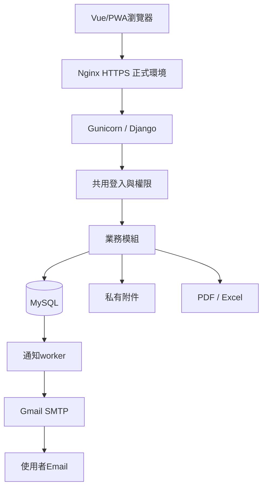

# ZY_WEB技術架構與檔案用途說明

更新日期：2026-11-10（Asia/Taipei）  
版本：Vue＋PWA改版；只保留本次必要測試與任務紀錄。既有業務模組及資料遷移未改寫。

操作請讀[安裝部署與帳號操作手冊](安裝部署與帳號操作手冊.md)。

## 1. 技術與架構

| 技術 | 目前版本／用途 |
|---|---|
| Python／Django | Python3.11、Django5.2.19；伺服器HTML、ORM、Session、CSRF與migrations |
| MySQL／mysqlclient | 本機MySQL8.4.13、mysqlclient2.3.0；InnoDB、utf8mb4與交易 |
| python-dotenv | 1.2.4；讀.env，既有程序環境變數優先 |
| Vue／TypeScript／Vite | 3.5.45／5.9.3／7.3.8；單頁前端，Node.js24 LTS建置 |
| Vue Router／Pinia | 4.6.4／3.0.4；路由與記憶體內登入狀態，不持久化敏感資料 |
| Lucide圖示／自訂CSS | 共用元件、桌面側欄、手機卡片與獨立登入頁 |
| vite-plugin-pwa | 1.1.0；Manifest、Service Worker、提示更新與安裝引導 |
| Django REST Framework | 3.18.3；同源JSON API、Session認證與匿名登入CSRF驗證 |
| openpyxl | 3.1.5；依權限匯出Excel並防止文字被當成公式 |
| ReportLab | 5.1.0；PDF長文分頁與嵌入中文字型 |
| Pillow／pypdf | 13.0.0／7.0.0；驗證上傳圖片及PDF內容，屬正式功能依賴，不移除 |
| Gmail SMTP | 587 STARTTLS、應用程式密碼；系統寄件，各使用者Email收件 |
| 資料庫outbox worker | process_notifications --loop；非Celery／Redis，須獨立啟動 |
| Gunicorn／Nginx／Docker | Linux正式服務、HTTPS代理及持久化資料卷；現有設定仍需目標主機驗證 |

固定套件版本以[requirements.txt](../backend/requirements.txt)為準。本次API測試使用Django測試工具，瀏覽器測試需額外安裝Playwright；PWA政策測試用Node內建runner，不增加測試框架。npm版本由frontend/package-lock.json鎖定。

Windows本機先建置frontend/dist，再由runserver提供Vue外殼與同源/api/；正式環境Nginx直接提供Vue靜態檔，將API與下載轉送Gunicorn。程式碼前後端分開，使用者仍只有同一個網站網域。

## 2. 核心規則

- 報修者看自己、公司管理者看本公司、贊耀公司人員可查看及管理全部案件，透過接手及交接記錄責任歸屬。
- 贊耀公司人員可管理全系統帳號；公司管理者可建立及管理本公司報修者，包含資料修改、重設臨時密碼、啟停與邏輯刪除。
- Email選填；臨時密碼24小時、首次／後台重設後強制改密碼；正式密碼至少10字元。
- 報修者忘記密碼可由本公司管理者或贊耀公司人員確認身分並重設臨時密碼，公司管理者由贊耀公司人員協助；不提供Email驗證或自助重設。
- 表單欄位與答案存JSON；已發布版本不可改寫，舊版預設再接受24小時，也可立即停止；切換保留文字，Vue版附件保留於當前頁面記憶體。
- 發布與提交鎖同一公司列，修改案件用revision拒絕過時內容。
- 公開紀錄與內部備註分開，附件／通知／搜尋／匯出均沿用權限。
- PDF／Excel最多1000件，附件只列檔名；圖片／PDF單檔10MB、每次最多5檔。
- 帳號採邏輯刪除；停用後重新啟用仍需重設臨時密碼，歷史保留。
- SMTP接受不代表收件匣已收到；worker採至少一次投遞，故障邊界可能重複。
- 舊Excel資料未自動移轉；保存期限、正式備份排程與憑證續期由接手者確認。

## 3. 資料與目錄

| 位置 | 用途 |
|---|---|
| backend/apps/、backend/common/、backend/config/ | 業務模組、共用驗證與Django設定 |
| backend/templates/、backend/static/ | HTML、CSS、JavaScript及本地Bootstrap |
| scripts/ | 本機MySQL啟動／新初始化、網站啟動、環境檢查 |
| backend/deployment/ | Dockerfile、Compose與Nginx |
| docs/ | 交接手冊與Vue_PWA_改版任務.md |
| frontend/ | Vue原始碼、元件、PWA、Node政策測試與鎖檔；node_modules與dist可重建 |
| MySQL zy_web | 公司、帳號、表單、案件、歷程、通知、audit與Session |
| private_media/ | 真正附件，以隨機key對應Attachment，不能公開掛載 |
| mysql_data/、.tools/ | 本機使用中的MySQL資料與便攜執行檔，保留以維持啟動 |
| .venv/ | 目前使用中的Python環境，新電腦重新安裝 |

主要模型為Company、Location、Recipient、User、ActionToken、LoginAttempt、FormVersion、Ticket、Entry、AssignmentHistory、StatusHistory、Attachment、Notification、Delivery、AuditLog，另有Django系統與關聯表。FormVersion.fields及Ticket.answers存JSON，並非每個動態欄位一張表。reports只生成回應，不需要業務資料表。

## 4. 目前保留檔案的逐檔用途

以下列出精簡後的自研與部署檔案；第三方套件與MySQL內部資料不逐檔列出，也不手動刪改其內容。

### 根目錄與後端入口

| 檔案 | 用途 |
|---|---|
| [.dockerignore](../.dockerignore) | 排除本機機密與執行資料，避免被COPY到Docker映像。 |
| [.env.example](../.env.example) | 可交付的環境變數範例；不含實際密碼，Email預設console。 |
| [.gitignore](../.gitignore) | 排除.env、資料庫、附件、備份、PID與快取等不應提交項目。 |
| [AGENTS.md](../AGENTS.md) | 維護規則：先讀兩份手冊、維持權限／資料／機密與必要驗證。 |
| [README.md](../README.md) | 精簡專案入口、啟動命令與兩份手冊連結。 |
| [manage.py](../backend/manage.py) | Django命令入口：migrate、runserver、test及自訂命令。 |
| [requirements.txt](../backend/requirements.txt) | 應用執行依賴及固定版本。 |

### apps

| 檔案 | 用途 |
|---|---|
| [__init__.py](../backend/apps/__init__.py) | Python套件標記，目前無業務流程。 |

### apps/accounts

| 檔案 | 用途 |
|---|---|
| [__init__.py](../backend/apps/accounts/__init__.py) | Python套件標記，目前無業務流程。 |
| [apps.py](../backend/apps/accounts/apps.py) | Django AppConfig註冊模組名稱、label及預設主鍵型態。 |
| [forms.py](../backend/apps/accounts/forms.py) | 登入、改密碼與帳號維護表單，驗證帳號格式與公司／角色組合。 |
| [models.py](../backend/apps/accounts/models.py) | 自訂User、角色／公司一致性限制、ActionToken及登入失敗計數。 |
| [services.py](../backend/apps/accounts/services.py) | 隨機臨時密碼、雜湊憑證、一次性重設／Email驗證與到期處理。 |
| [urls.py](../backend/apps/accounts/urls.py) | accounts相關路由的子路由表。 |
| [views.py](../backend/apps/accounts/views.py) | 登入登出、失敗限制、改密碼、忘記密碼、驗證及帳號生命週期畫面處理。 |

### apps/accounts/management

| 檔案 | 用途 |
|---|---|
| [__init__.py](../backend/apps/accounts/management/__init__.py) | Python套件入口；migrations／management下用於讓Django發現遷移或自訂命令。 |

### apps/accounts/management/commands

| 檔案 | 用途 |
|---|---|
| [__init__.py](../backend/apps/accounts/management/commands/__init__.py) | Python套件入口；migrations／management下用於讓Django發現遷移或自訂命令。 |
| [bootstrap_admin.py](../backend/apps/accounts/management/commands/bootstrap_admin.py) | 只在尚無贊耀公司人員時建立第一位，顯示當次臨時密碼。 |
| [recover_admin.py](../backend/apps/accounts/management/commands/recover_admin.py) | 由主機維運者復原啟用中的贊耀公司人員，產生新臨時密碼。 |

### apps/accounts/migrations

| 檔案 | 用途 |
|---|---|
| [0001_initial.py](../backend/apps/accounts/migrations/0001_initial.py) | 此模組首次資料庫結構遷移，migrate依依賴順序建表／限制；不是啟動網站的程式。 |
| [__init__.py](../backend/apps/accounts/migrations/__init__.py) | Python套件入口；migrations／management下用於讓Django發現遷移或自訂命令。 |

### apps/attachments

| 檔案 | 用途 |
|---|---|
| [__init__.py](../backend/apps/attachments/__init__.py) | Python套件標記，目前無業務流程。 |
| [apps.py](../backend/apps/attachments/apps.py) | Django AppConfig註冊模組名稱、label及預設主鍵型態。 |
| [models.py](../backend/apps/attachments/models.py) | 附件key、名稱、大小、型態、所屬案件／留言及內部可見性。 |
| [services.py](../backend/apps/attachments/services.py) | 檔案大小／數量與內容驗證、隨機key私有保存及失敗清理。 |
| [views.py](../backend/apps/attachments/views.py) | 授權後以附件方式下載，不直接提供公開檔案路徑。 |

### apps/attachments/migrations

| 檔案 | 用途 |
|---|---|
| [0001_initial.py](../backend/apps/attachments/migrations/0001_initial.py) | 此模組首次資料庫結構遷移，migrate依依賴順序建表／限制；不是啟動網站的程式。 |
| [__init__.py](../backend/apps/attachments/migrations/__init__.py) | Python套件入口；migrations／management下用於讓Django發現遷移或自訂命令。 |

### apps/audit

| 檔案 | 用途 |
|---|---|
| [__init__.py](../backend/apps/audit/__init__.py) | Python套件標記，目前無業務流程。 |
| [apps.py](../backend/apps/audit/apps.py) | Django AppConfig註冊模組名稱、label及預設主鍵型態。 |
| [models.py](../backend/apps/audit/models.py) | AuditLog操作人、角色、公司、動作、對象、摘要、結果、來源與時間。 |
| [services.py](../backend/apps/audit/services.py) | 共用log寫入入口，不將密碼或完整重設憑證放入紀錄。 |
| [views.py](../backend/apps/audit/views.py) | 僅贊耀公司人員可用的操作紀錄篩選與分頁。 |

### apps/audit/migrations

| 檔案 | 用途 |
|---|---|
| [0001_initial.py](../backend/apps/audit/migrations/0001_initial.py) | 此模組首次資料庫結構遷移，migrate依依賴順序建表／限制；不是啟動網站的程式。 |
| [__init__.py](../backend/apps/audit/migrations/__init__.py) | Python套件入口；migrations／management下用於讓Django發現遷移或自訂命令。 |

### apps/companies

| 檔案 | 用途 |
|---|---|
| [__init__.py](../backend/apps/companies/__init__.py) | Python套件標記，目前無業務流程。 |
| [apps.py](../backend/apps/companies/apps.py) | Django AppConfig註冊模組名稱、label及預設主鍵型態。 |
| [models.py](../backend/apps/companies/models.py) | Company、Location、Recipient：公司、據點及事件通知收件人。 |
| [views.py](../backend/apps/companies/views.py) | 贊耀公司人員新增／修改／停用公司、據點與收件人，新公司自建V1表單。 |

### apps/companies/migrations

| 檔案 | 用途 |
|---|---|
| [0001_initial.py](../backend/apps/companies/migrations/0001_initial.py) | 此模組首次資料庫結構遷移，migrate依依賴順序建表／限制；不是啟動網站的程式。 |
| [__init__.py](../backend/apps/companies/migrations/__init__.py) | Python套件入口；migrations／management下用於讓Django發現遷移或自訂命令。 |

### apps/forms

| 檔案 | 用途 |
|---|---|
| [__init__.py](../backend/apps/forms/__init__.py) | Python套件標記，目前無業務流程。 |
| [apps.py](../backend/apps/forms/apps.py) | Django AppConfig註冊模組名稱、label及預設主鍵型態。 forms使用form_definitions label。 |
| [models.py](../backend/apps/forms/models.py) | FormVersion及唯一版本號；已發布欄位／歸屬／版本不可改寫。 |
| [services.py](../backend/apps/forms/services.py) | 欄位結構驗證、動態Django表單、最新版本、接受期限與發布交易。 |
| [views.py](../backend/apps/forms/views.py) | 管理者草稿建立／修改／複製及版本發布。 |

### apps/forms/migrations

| 檔案 | 用途 |
|---|---|
| [0001_initial.py](../backend/apps/forms/migrations/0001_initial.py) | 此模組首次資料庫結構遷移，migrate依依賴順序建表／限制；不是啟動網站的程式。 |
| [__init__.py](../backend/apps/forms/migrations/__init__.py) | Python套件入口；migrations／management下用於讓Django發現遷移或自訂命令。 |

### apps/notifications

| 檔案 | 用途 |
|---|---|
| [__init__.py](../backend/apps/notifications/__init__.py) | Python套件標記，目前無業務流程。 |
| [apps.py](../backend/apps/notifications/apps.py) | Django AppConfig註冊模組名稱、label及預設主鍵型態。 |
| [models.py](../backend/apps/notifications/models.py) | Notification站內通知與Delivery寄信outbox／重試狀態。 |
| [services.py](../backend/apps/notifications/services.py) | 案件事件通知、收件人判斷、寄送批次鎖定、失敗退避重試。 |
| [views.py](../backend/apps/notifications/views.py) | 自己的通知列表、目前案件可見性篩選及標示已讀。 |

### apps/notifications/management

| 檔案 | 用途 |
|---|---|
| [__init__.py](../backend/apps/notifications/management/__init__.py) | Python套件入口；migrations／management下用於讓Django發現遷移或自訂命令。 |

### apps/notifications/management/commands

| 檔案 | 用途 |
|---|---|
| [__init__.py](../backend/apps/notifications/management/commands/__init__.py) | Python套件入口；migrations／management下用於讓Django發現遷移或自訂命令。 |
| [process_notifications.py](../backend/apps/notifications/management/commands/process_notifications.py) | 寄信worker；不加--loop處理一批，加--loop持續輪詢。 |

### apps/notifications/migrations

| 檔案 | 用途 |
|---|---|
| [0001_initial.py](../backend/apps/notifications/migrations/0001_initial.py) | 此模組首次資料庫結構遷移，migrate依依賴順序建表／限制；不是啟動網站的程式。 |
| [__init__.py](../backend/apps/notifications/migrations/__init__.py) | Python套件入口；migrations／management下用於讓Django發現遷移或自訂命令。 |

### apps/reports

| 檔案 | 用途 |
|---|---|
| [__init__.py](../backend/apps/reports/__init__.py) | Python套件標記，目前無業務流程。 |
| [apps.py](../backend/apps/reports/apps.py) | Django AppConfig註冊模組名稱、label及預設主鍵型態。 |
| [views.py](../backend/apps/reports/views.py) | 依權限產生PDF／Excel，包含可見處理內容與附件檔名，嵌入中文字型。 |

### apps/reports/migrations

| 檔案 | 用途 |
|---|---|
| [__init__.py](../backend/apps/reports/migrations/__init__.py) | Python套件入口；migrations／management下用於讓Django發現遷移或自訂命令。 |

### apps/tickets

| 檔案 | 用途 |
|---|---|
| [__init__.py](../backend/apps/tickets/__init__.py) | Python套件標記，目前無業務流程。 |
| [apps.py](../backend/apps/tickets/apps.py) | Django AppConfig註冊模組名稱、label及預設主鍵型態。 |
| [forms.py](../backend/apps/tickets/forms.py) | 固定報修欄位、補充、派工、狀態與revision表單驗證。 |
| [models.py](../backend/apps/tickets/models.py) | 案件、報修快照／JSON答案、revision、留言、派工與狀態歷史。 |
| [services.py](../backend/apps/tickets/services.py) | 案件建立、鎖定與版本衝突、派工、狀態機、留言及通知交易。 |
| [views.py](../backend/apps/tickets/views.py) | 案件工作台／篩選／分頁、送出、轉版內容保留、版本狀態API及明細。 |

### apps/tickets/migrations

| 檔案 | 用途 |
|---|---|
| [0001_initial.py](../backend/apps/tickets/migrations/0001_initial.py) | 此模組首次資料庫結構遷移，migrate依依賴順序建表／限制；不是啟動網站的程式。 |
| [__init__.py](../backend/apps/tickets/migrations/__init__.py) | Python套件入口；migrations／management下用於讓Django發現遷移或自訂命令。 |

### common

| 檔案 | 用途 |
|---|---|
| [__init__.py](../backend/common/__init__.py) | Python套件標記，目前無業務流程。 |
| [auth.py](../backend/common/auth.py) | 自訂認證Backend，拒絕停用、刪除、公司停用或臨時密碼過期帳號。 |
| [context.py](../backend/common/context.py) | 提供導覽未讀通知數，排除已無權查看的案件通知。 |
| [middleware.py](../backend/common/middleware.py) | AccountGate：未改臨時密碼只能前往改密碼或登出。 |
| [permissions.py](../backend/common/permissions.py) | 角色檢查、各角色可見案件、公開／內部留言與附件範圍。 |
| [response.py](../backend/common/response.py) | 私有頁面no-store、Referrer Policy及403／404存取拒絕紀錄。 |

### config

| 檔案 | 用途 |
|---|---|
| [__init__.py](../backend/config/__init__.py) | Python套件標記，目前無業務流程。 |
| [asgi.py](../backend/config/asgi.py) | ASGI入口；目前Compose未使用ASGI伺服器。 |
| [settings.py](../backend/config/settings.py) | 讀.env、註冊模組與中介層、MySQL／SMTP／Session／HTTPS設定及測試庫防護。 |
| [urls.py](../backend/config/urls.py) | 全站路由：帳號、案件、公司、表單、附件、通知、audit與報表。 |
| [wsgi.py](../backend/config/wsgi.py) | 同步WSGI應用入口，正式Gunicorn使用。 |

### deployment

| 檔案 | 用途 |
|---|---|
| [Dockerfile](../backend/deployment/Dockerfile) | Linux應用映像、mysqlclient系統依賴、中文字型、非root app使用者及Gunicorn。 |
| [compose.yaml](../backend/deployment/compose.yaml) | db／web／worker／proxy及資料卷；web與worker有覆蓋部分.env的environment。 |
| [nginx.conf](../backend/deployment/nginx.conf) | 443 TLS、靜態檔案、反向代理及上傳大小；未包含80轉址／憑證自動續期。 |

### docs

| 檔案 | 用途 |
|---|---|
| [安裝部署與帳號操作手冊.md](安裝部署與帳號操作手冊.md) | 全新安裝、日常啟動、正式部署、帳號建立與維運。 |
| [技術架構與檔案用途說明.md](技術架構與檔案用途說明.md) | 本文件：精簡後技術架構與逐檔用途。 |

### scripts

| 檔案 | 用途 |
|---|---|
| [check_environment.py](../scripts/check_environment.py) | 讀取MySQL版本、Schema、引擎與編碼，基本環境診斷。 |
| [run_dev.ps1](../scripts/run_dev.ps1) | 在根目錄檢查Django後以前景runserver啟動，不會同時啟動worker。 |
| [setup_mysql.py](../scripts/setup_mysql.py) | Windows開發用MySQL新實例初始化，3307、mysql_data；會建立憑證與資料庫，不作一般重啟。 |
| [start_mysql.ps1](../scripts/start_mysql.ps1) | 啟動已初始化的Windows便攜MySQL，不重建資料；固定本地3307及便攜路徑。 |

### static/css

| 檔案 | 用途 |
|---|---|
| [app.css](../backend/static/css/app.css) | 品牌與響應式版面、側欄、表格、表單、手機排版；引用本地Bootstrap。 |

### static/js

| 檔案 | 用途 |
|---|---|
| [app.js](../backend/static/js/app.js) | 敏感操作確認、拖曳貼上預覽、版本輪詢與可視化欄位編輯器。 |

### static/vendor

| 檔案 | 用途 |
|---|---|
| [bootstrap.min.css](../backend/static/vendor/bootstrap.min.css) | 本地Bootstrap第三方CSS，隨部署提供而非每次從CDN下載。 |

### templates/accounts

| 檔案 | 用途 |
|---|---|
| [login.html](../backend/templates/accounts/login.html) | 帳號登入及忘記密碼入口。 |
| [temporary.html](../backend/templates/accounts/temporary.html) | 新建／重設後僅當次顯示臨時密碼，禁止快取。 |
| [users.html](../backend/templates/accounts/users.html) | 帳號列表、修改、臨時密碼重設與啟停／刪除操作。 |

### templates/audit

| 檔案 | 用途 |
|---|---|
| [list.html](../backend/templates/audit/list.html) | 管理者操作紀錄查詢及表格。 |

### templates

| 檔案 | 用途 |
|---|---|
| [base.html](../backend/templates/base.html) | 共用頁框、角色導覽、通知數、Email提示與靜態資源。 |
| [generic_form.html](../backend/templates/generic_form.html) | 一般新增／編輯／改密碼／憑證確認表單外觀。 |
| [message.html](../backend/templates/message.html) | 一般錯誤或狀態提示頁。 |
| [pagination.html](../backend/templates/pagination.html) | 共用分頁，保留查詢條件。 |

### templates/companies

| 檔案 | 用途 |
|---|---|
| [list.html](../backend/templates/companies/list.html) | 公司列表與新增／管理入口。 |

### templates/forms

| 檔案 | 用途 |
|---|---|
| [versions.html](../backend/templates/forms/versions.html) | 表單草稿編輯器、複製、版本歷史與發布政策。 |

### templates/notifications

| 檔案 | 用途 |
|---|---|
| [list.html](../backend/templates/notifications/list.html) | 自己的站內通知與已讀操作。 |

### templates/tickets

| 檔案 | 用途 |
|---|---|
| [detail.html](../backend/templates/tickets/detail.html) | 報修快照、附件、公開／內部歷程、派工及狀態更新。 |
| [list.html](../backend/templates/tickets/list.html) | 依權限工作台、統計、查詢、分頁與匯出。 |
| [new.html](../backend/templates/tickets/new.html) | 固定及動態報修欄位、版本提示、轉版與附件。 |
| [select_company.html](../backend/templates/tickets/select_company.html) | 贊耀公司人員代報修時先選公司。 |

## 5. 機密與執行資料

.env含SECRET_KEY、資料庫及SMTP帳密，不公開；.mysql-admin.env是本機便攜MySQL管理憑證。三個PID檔只記錄本機程序，不是自動啟動設定，也不能搬到別的主機沿用。

目前mysql_data與private_media保留全部內容，本次不清理資料庫或附件。test_zy_web是MySQL內的既有測試庫，本次僅整理專案檔案，不刪除它。未來若要移除資料庫，需另確認資料庫範圍，不能直接刪除mysql_data中的檔案。

新主機從.env.example建立自己的.env、重建.venv、使用migrate建表。SQL與附件只在有資料移轉需求時受控備份交付。Docker使用named volumes，不沿用Windows的mysql_data。

## 6. 本次清理與驗證範圍

移除自動測試程式、requirements-dev.txt、測試啟動／還原工具、測試日誌／截圖／範例PDF、一次性驗證備份、重複規範／任務／原始討論文件與快取。所有migrations及正式功能依賴保留。

先前64項測試與Gmail SMTP接受屬歷史驗證，不再保留其檔案，也不宣稱本次重新執行整套自動測試。本次Vue改版驗證與變更範圍另見[任務紀錄](Vue_PWA_改版任務.md)。Docker／正式HTTPS仍須部署者於目標主機驗證。

## 7. Vue/API改版新增的檔案

下列檔案僅屬本次改版。原templates及static/css、static/js保留為舊版相容頁面，不是新版Vue畫面的修改位置。

| 檔案 | 用途 |
|---|---|
| [frontend/package.json](../frontend/package.json)／[package-lock.json](../frontend/package-lock.json) | 建置命令、前端依賴及可重現版本；overrides固定已驗證的PWA工具鏈依賴 |
| [frontend/tsconfig.json](../frontend/tsconfig.json) | Vue與TypeScript嚴格型別檢查 |
| [frontend/vite.config.ts](../frontend/vite.config.ts) | Vue建置、同源API開發代理、PWA資訊與公開靜態資源快取 |
| [frontend/index.html](../frontend/index.html) | 純公開應用外殼，不含登入者或案件資料 |
| [frontend/src/main.ts](../frontend/src/main.ts) | 掛載Vue、Pinia、Router與樣式 |
| [frontend/src/App.vue](../frontend/src/App.vue) | 桌面／手機版型、側欄、通知、安裝與提示更新 |
| [frontend/src/api.ts](../frontend/src/api.ts) | 同源請求、CSRF、JSON錯誤與Session失效處理 |
| [frontend/src/pwaPolicy.ts](../frontend/src/pwaPolicy.ts) | 排除API／附件／報表／驗證連結的快取與導覽規則 |
| [frontend/src/router/index.ts](../frontend/src/router/index.ts) | 頁面、角色導覽、首次改密碼與未送出內容提醒 |
| [frontend/src/stores/auth.ts](../frontend/src/stores/auth.ts)／[ui.ts](../frontend/src/stores/ui.ts) | 記憶體內登入與介面狀態，不使用localStorage存帳密／案件 |
| [frontend/src/styles/app.css](../frontend/src/styles/app.css) | 統一色彩、字級、間距與響應式版型 |
| [scripts/build_frontend.ps1](../scripts/build_frontend.ps1) | Windows前端安裝／建置，支援本機便攜Node |
| [apps/api/authentication.py](../backend/apps/api/authentication.py) | 包括匿名登入在內的CSRF驗證 |
| [apps/api/helpers.py](../backend/apps/api/helpers.py) | API錯誤格式、分頁、表單錯誤與使用者資料 |
| [apps/api/auth.py](../backend/apps/api/auth.py) | Session、登入、登出、強制改密碼、驗證與密碼重設API |
| [apps/api/tickets.py](../backend/apps/api/tickets.py) | 案件查詢、報修、版本資訊、派工、處理與留言API |
| [apps/api/management.py](../backend/apps/api/management.py) | 公司、帳號、表單、通知與操作紀錄API |
| [apps/api/urls.py](../backend/apps/api/urls.py) | /api/路由 |
| [apps/api/shell.py](../backend/apps/api/shell.py) | Vue外殼及本機靜態建置檔案；正式由Nginx提供靜態資源 |
| [apps/api/tests.py](../backend/apps/api/tests.py) | 本次MySQL API隔離與流程測試 |
| [apps/api/browser_tests.py](../backend/apps/api/browser_tests.py) | Edge瀏覽器、手機版、PWA離線與更新驗證，僅用測試資料 |
| [frontend/tests/pwa.test.mjs](../frontend/tests/pwa.test.mjs) | Node內建runner測試私有路由排除政策 |

### Vue功能頁

| 檔案 | 用途 |
|---|---|
| [ActivityView.vue](../frontend/src/views/ActivityView.vue) | 站內通知與管理者操作紀錄。 |
| [AuthView.vue](../frontend/src/views/AuthView.vue) | 登入、忘記密碼、個人密碼與一次性驗證／重設頁。 |
| [CompaniesView.vue](../frontend/src/views/CompaniesView.vue) | 公司新增／修改與據點、收件人。 |
| [DashboardView.vue](../frontend/src/views/DashboardView.vue) | 統計、案件列表、公司／日期篩選、匯出與Email驗證。 |
| [TicketCreateView.vue](../frontend/src/views/TicketCreateView.vue) | 新報修、動態欄位、附件及版本切換保留內容。 |
| [TicketDetailView.vue](../frontend/src/views/TicketDetailView.vue) | 案件快照、處理歷程、內部留言、派工與狀態。 |
| [UsersView.vue](../frontend/src/views/UsersView.vue) | 各角色帳號維護、臨時密碼單次顯示。 |
| [VersionsView.vue](../frontend/src/views/VersionsView.vue) | 草稿、欄位編輯／排序、複製及發布。 |

### Vue共用元件

| 檔案 | 用途 |
|---|---|
| [AttachmentPicker.vue](../frontend/src/components/AttachmentPicker.vue) | 拖曳／貼上／選取附件與預覽。 |
| [FieldErrors.vue](../frontend/src/components/FieldErrors.vue) | 表單錯誤提示。 |
| [PageHeading.vue](../frontend/src/components/PageHeading.vue) | 統一頁面標題與動作。 |
| [Pagination.vue](../frontend/src/components/Pagination.vue) | 列表分頁。 |
| [StatusBadge.vue](../frontend/src/components/StatusBadge.vue) | 案件狀態標籤。 |

### 公開PWA資源

| 檔案 | 用途 |
|---|---|
| [favicon.svg](../frontend/public/favicon.svg) | 網站圖示。 |
| [offline.html](../frontend/public/offline.html) | 純公開離線說明頁。 |
| [pwa-192.png](../frontend/public/pwa-192.png) | 192px安裝圖示。 |
| [pwa-512.png](../frontend/public/pwa-512.png) | 512px及maskable安裝圖示。 |

### 同源登入及PWA注意事項

前端不使用JWT或localStorage保存登入。後端維持SessionCookie與CSRF；/api/未登入回401，未完成臨時密碼更換回指定JSON狀態。實際權限仍由後端判斷。

只快取公開Vue外殼、JS、CSS、圖示；API、附件、報表與驗證連結走網路，登出時清空前端使用者狀態。離線不送單、不自動重送，避免重複或誤認已受理。更新需要使用者確認，有未送出內容則阻止重新載入。

部署新增Node建置階段、Nginx的Vue History fallback、/sw.js與Manifest快取標頭，以及web／worker／proxy不同Docker target。前端不能使用VITE_環境變數保存任何機密。

## 目錄整理補充

後端原始碼及部署設定集中於backend；前端、文件及跨專案腳本維持根目錄同層。根目錄PROJECT_SPEC.md為規格入口，TASKS.md記錄整理任務與驗收。Django BASE_DIR為backend，PROJECT_DIR為專案根目錄，.env與附件實際路徑保持不變。Docker建置context仍為根目錄；compose位於backend/deployment。

## 報表格式更新（2026-11-11）

PDF與Excel均以一筆案件一列、UI名稱作欄位標題；同案多筆處理紀錄或附件檔名在同一儲存格內換行，動態欄位依此次匯出的案件彙整成欄。為避免與固定欄位混淆，同名動態欄位會加註「報修欄位」。匯出權限、篩選與最多1000件限制不變。

Excel為單一工作表、凍結標題列與單號欄；PDF為橫向A3，欄位多時分組分頁，每組重複單號，跨頁重複標題，長文字可續頁。下載檔名使用台灣當下時間及民國年，例如1151111_1521.pdf、1151111_1521.xlsx。

## 每日案件單號（2026-11-11）

新案件使用「公司代碼大寫＋台灣當日西元日期＋流水號」，例如YF20261111-001。各公司、各日期獨立累加，最少三碼，超過999後使用1000。公司代碼變更只影響新案件前綴，同公司當日流水號繼續累加；舊單號不重寫。

新增tickets.DailyTicketCounter模型（資料表tickets_dailyticketcounter）：company、date、last_number，company＋date具唯一限制。建立案件的交易先鎖公司，再鎖當日計數器，更新計數器與建立案件一併提交。取號不使用案件筆數，取消或移除已建立案件不回收、不補號；不得手動刪除或重設計數器。交易失敗且案件未成立時，取號也會回滾。

部署必須執行`.\.venv\Scripts\python.exe backend/manage.py migrate --noinput`套用tickets/0002_daily_ticket_counter.py後再啟動新版本。此遷移只新增計數表，不改寫舊案件、通知或附件。既有UUID public_id保留。

本次沒有新增刪除案件介面、邏輯刪除欄位或更動取消／結案流程；誤報仍使用已取消狀態。備份與還原需包含每日計數表，不能只還原案件表而遺漏計數器。

## 贊耀公司人員角色整合（2026-11-11，取代早先工程師分權規範）

目前僅有公司報修者、公司管理者、贊耀公司人員三種角色。既有engineer帳號經accounts/0002_unified_zy_staff遷移轉為it_admin，保留pk、密碼、登入狀態、案件歸屬與歷史；it_admin顯示名稱改為贊耀公司人員。停用與已刪除帳號也轉換角色，但維持原啟用／刪除狀態。帳號管理不再提供工程師角色。

tickets/0003_pending_takeover_label僅將unassigned顯示名稱改為待接手；歷史assigned狀態與資料保持原樣。新案件按接手處理後進入processing，保留責任人及操作歷程；交接仍沿用既有engineer資料欄位與assign API，以減少資料搬移，畫面統一顯示負責人／交接。

部署先停止網站，執行backend/manage.py migrate --noinput，再啟動新版網站；需重新建置frontend。遷移回退不自動將整合後帳號拆回舊工程師角色，需另行受控處理。仍禁止停用最後一位有效贊耀公司人員，有未結案件的負責人須先交接才能停用。

## 個人設定（2026-11-11）

右上角頭貼或姓名可進入/settings/profile/；側邊修改密碼入口已移除。個人設定可修改顯示姓名、電話／分機、手機及選填Email，並使用目前密碼變更新密碼。登入帳號、公司、角色、工號、部門、辦公室與帳號啟用狀態不開放本人修改。

Email可填寫、更換或清除，不需驗證。維修通知依已儲存的信箱寄送；忘記密碼統一由贊耀公司人員重設臨時密碼，舊驗證與Email重設連結停止使用。

後端GET／POST /api/auth/profile/只操作登入者，以ProfileForm白名單驗證欄位，真實變更寫入account.profile_updated操作紀錄，只記變動欄位名稱，不記密碼或驗證碼。只更新User，不改寫既有Ticket.snapshot。首次臨時密碼仍使用原強制改密碼頁，前端路由及後端API都禁止繞過進入個人設定。

新增frontend/src/views/ProfileView.vue，沿用現有auth/password API（auth/verify已停用）；不改資料表、不增加migration，也未修改管理者維護他人資料的規則。

## 密碼復原與Email通知最新規則（2026-11-11）

Email僅用於維修進度通知，維持選填與格式檢查，無驗證步驟。個人設定與首頁不再顯示驗證提示；忘記密碼頁改為聯絡說明。贊耀公司人員於帳號管理重設臨時密碼，確認本人身分後交付；24小時內登入必須先設定與臨時密碼不同的新密碼，完成前前端與後端都禁止其他功能。原密碼及舊登入撤銷，重設與修改均有操作紀錄。

舊auth/token、auth/verify API與舊驗證頁回應停用，issue_token／consume_token服務拒絕操作；舊連結即使尚未過期也不能驗證或改密碼。auth/forgot僅回聯絡說明，不查詢帳號、不排信。email_verified_at及ActionToken資料結構保留作歷史相容，不作通知寄送條件；無資料庫遷移。維修通知SMTP／worker及主機端recover_admin維持原流程。本節取代較早的信箱驗證／Email自助復原說明。

## Email只通知接手與完成（2026-11-11）

只有按「接手處理」（進入處理中）與更新為「已完成」會排入Email。新報修、交接、公開補充、內部備註、待客戶回覆、恢復處理中、重開、結案與取消均不排信。重複接手被交易檢查拒絕，不重複排信；重新處理後再次完成會寄完成通知。

站內通知及小鈴鐺維持原規則。維修通知收件人沿用報修人、該公司啟用管理者、目前負責人，以及符合事件設定的額外收件人；有Email才寄，同地址去重。公司額外收件人事件仍沿用assigned（接手）及completed（完成）設定。

技術上event預設send_email=False，接手與完成操作才明確開啟；SMTP、process_notifications、重試、權限與資料庫結構不變。本次不追溯修改已排入或已寄出的歷史郵件。

## 贊耀服務平台與模組導覽（2026-11-11）

網站登入頁、主版型、頁面標識、瀏覽器標題、PWA名稱與離線頁名稱改為贊耀服務平台，品牌副標為贊耀電腦｜銷售・維修・資訊服務。側邊原工作空間改為報修系統入口按鈕，可點擊或用鍵盤Enter／空白鍵展開及收合；目前報修頁面預設展開，子功能保持原角色權限與選取標示。頁面切換後自動展開所屬模組，手機選取功能後關閉側邊選單。

個人設定維持右上頭貼，安裝與登出保留底部，不隨模組收合。麵包屑顯示報修系統入口與當前功能；個人設定則屬平台共用頁。收合狀態只保存在目前頁面記憶體，不儲存個人或案件資料。

frontend/src/navigation.ts集中定義系統模組id、名稱、圖示、路徑前綴及各功能roles。未來新增模組時，在definitions加入設定，並另行實作其Vue頁面、路由與後端權限／API；導覽設定本身不會自動建立新系統或取代後端授權。第一版沒有空的其他系統選單。

更新前端需重新build。一般網頁重新整理即可載入，已安裝PWA若提示有新版，先完成未送出的內容再按立即更新；裝置顯示名稱更新速度依瀏覽器而異。此改版沒有修改報修業務、資料庫、API授權、Email或報表範本。

## 科技藍配色（2026-11-11）

側邊背景#0F172A；第一層系統入口固定#1E3A5F底、#F8FAFC粗體字，收合仍保留底色。第二層一般功能使用透明底與#CBD5E1文字，滑入#1E293B；選中項目改為#CFFAFE底、#164E63字，搭配#22D3EE選取線。鍵盤焦點以亮青藍外框顯示。主背景#F4F7FB，主要按鈕#2563EB搭白字，滑入#1D4ED8。

樣式調整位於frontend/src/styles/app.css與App.vue的模組樣式；index.html及vite.config.ts同步PWA theme-color。成功、警告與錯誤維持既有綠、橙、紅。此改版只變更外觀，功能、角色、資料與路由不變。一般重新整理，或完成未送出內容後接受PWA新版，即可載入。

## 操作紀錄介面調整（2026-11-12）

前端操作紀錄選單與路由已移除，舊 /audit/ 網址返回案件總覽。後端持續寫入 AuditLog，資料庫與既有受權限控管的查詢 API 保留。

## 系統設定模組（2026-11-12）

- frontend/src/views/SystemSettingsView.vue 提供贊耀公司人員專用的基本資料、SMTP 與測試寄信畫面。側欄入口位於「報修系統入口」子選單內，路由為 /settings/system/。
- backend/apps/api/system_settings.py 提供設定讀寫、revision 衝突檢查及測試信狀態 API，沿用 Session、CSRF、角色與臨時密碼限制。auth/session 只額外公開平台名稱、公司名稱及聯絡方式。
- backend/apps/notifications/models.py 新增單筆 SystemSettings，保存基本資料及加密 SMTP 設定。Delivery.is_test 區分測試信，既有資料預設 False。
- backend/apps/notifications/configuration.py 負責設定來源、公開欄位與 SMTP 連線，使用 cryptography 的 Fernet 加密密碼；獨立金鑰在 .env。services.deliver_batch 每次寄送讀取目前設定，保留原先重試機制。
- notifications/migrations/0002_delivery_is_test_systemsettings.py 建立必要結構，既有案件與附件維持原資料。backend/apps/api/system_settings_tests.py 針對權限、加密、併發版本、寄信重試及本機 SMTP 提供回歸驗證。

## 角色狀態與舊資料整併（2026-11-12）

贊耀公司人員的統計卡片及篩選為處理中、待客戶回覆、已完成、已取消；公司報修者與公司管理者為處理中、已完成、已取消。客戶端的處理中涵蓋待處理、處理中、待客戶回覆，清單、詳情與 PDF／Excel 使用相同呈現。桌面客戶端三張卡片平均分配寬度。

新報修的原始狀態改為 assigned（待處理），尚無負責人時仍可按接手處理，接手後轉 processing。維修進度信仍只於接手及已完成寄送。客戶端不再有已結案確認操作，贊耀人員可將已完成案件恢復處理中。

部署時執行 backend/manage.py migrate --noinput，tickets/0004_alter_ticket_status 會將既有 unassigned 轉 assigned、closed 轉 completed，案件 revision 加一以拒絕舊頁面更新，原單號、時間、報修內容及 StatusHistory 不改寫，另寫入遷移摘要操作紀錄。退回遷移不會自動還原已整併的原始狀態。已完成與已取消視為結束狀態，停用負責人時僅阻擋其他尚未完成的案件。

共用顯示、篩選、統計及可用轉換集中於 backend/apps/tickets/statuses.py；相應 API／資料遷移驗證位於 backend/apps/api/test_ticket_statuses.py，瀏覽器驗證包含三角色卡片、選單、等待回覆的客戶顯示與手機排版。

## 公司管理者帳號委派管理（2026-11-12）

UserForm 保留公司管理者建帳所需的登入帳號，既有帳號仍為唯讀；公司與角色欄位不開放輸入，表單實例固定為操作者公司及 reporter。API 與原帳號頁面共用 managed_users 範圍查詢，操作時於交易內鎖定並重新檢查可管理目標，維持贊耀角色的既有管理功能。

UsersView 開放公司管理者新增與帳號操作選單，顯示固定公司／角色。帳號管理新增、重設、啟停與刪除沿用既有臨時密碼與紀錄服務。必要回歸測試位於 backend/apps/api/test_company_accounts.py，涵蓋跨公司／角色限制、登入失效、強制改密碼、歷史快照及舊入口。

## 附件螢幕擷取（2026-11-12）

frontend/src/components/ScreenCapture.vue 使用 getDisplayMedia 取得授權畫面，以 Canvas 產生靜態 PNG 並立即停止串流；原生 dialog 提供預覽、框選與取消。框選使用 client 座標相對於實際 img 顯示範圍的比例，輸出依 naturalWidth／naturalHeight 換算像素，避免額外套用 devicePixelRatio。取消、卸載及延遲授權返回都釋放串流與預覽 URL。

AttachmentPicker.vue 串接擷取元件並提供 Windows 跨螢幕截圖貼上提示，既有上傳／貼上驗證沿用。TicketCreateView.vue 接收附件變更事件以標記未儲存狀態；詳情頁原有檔案監聽繼續使用。後端與資料庫結構無需調整。
